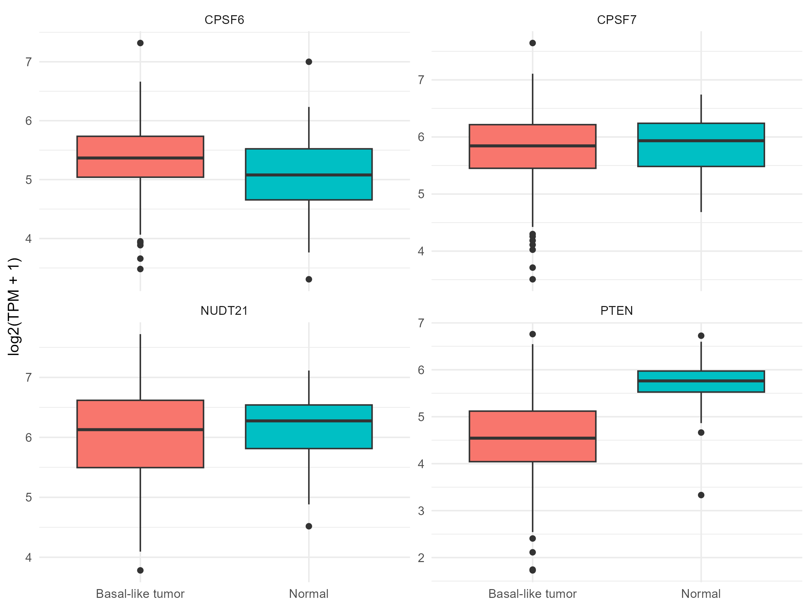

# PTEN-CFIm-TNBC-analysis
R analysis of TCGA-BRCA data showing PTEN loss and altered CFIm (CPSF6) expression in basal-like triple-negative breast cancer.

# PTEN and the CFIm Complex in Triple-Negative Breast Cancer

A small analysis of public TCGA-BRCA data in R.

## Background

PTEN is a tumor suppressor that slows the PI3K/AKT growth pathway. A recent study showed that the CFIm complex (NUDT21, CPSF6, CPSF7) controls how much PTEN protein is made by choosing where the PTEN mRNA tail is cut (alternative polyadenylation, APA). I wanted to see whether these genes are changed in triple-negative (basal-like) breast cancer.

This links to my interest in the RNA-level control of the PI3K/AKT/PTEN pathway in cancer.

## Question

Are PTEN and the CFIm genes different in basal-like breast tumors compared with normal breast tissue, and do they change together?

## Methods

- Data: TCGA-BRCA RNA-seq (TPM), downloaded with `TCGAbiolinks`
- Groups: basal-like tumors (PAM50) vs normal breast tissue
- Genes: PTEN, NUDT21 (CFIm25), CPSF6 (CFIm68), CPSF7 (CFIm59)
- Tests: Wilcoxon rank-sum test with Benjamini-Hochberg correction, and Spearman correlation within tumors
- Tools: R, RStudio, TCGAbiolinks, ggplot2

## Results

| Gene | Median in tumor | Median in normal | Adjusted p |
|---|---|---|---|
| **PTEN** | 4.54 | 5.76 | 1.0 × 10⁻³³ |
| NUDT21 | 6.13 | 6.27 | 0.42 |
| **CPSF6** | 5.37 | 5.08 | 1.1 × 10⁻⁴ |
| CPSF7 | 5.84 | 5.93 | 0.42 |

Values are log2(TPM + 1).

- PTEN is about 2.3 times lower in basal-like tumors.
- CPSF6 is slightly higher in tumors (about 1.2-fold).
- NUDT21 and CPSF7 do not differ.
- Inside tumors, CPSF6 and PTEN rise together (Spearman rho = 0.33, p = 2.9 × 10⁻⁶).

## Limits

- This shows association, not cause.
- Expression level does not show where the mRNA tail is cut, so APA itself was not measured.
- Tumor and normal samples come from different people, and tumor purity was not adjusted for.

## Next steps

- Measure APA directly (for example DaPars or an APA database for TCGA).

[Your name] · [email / LinkedIn]
